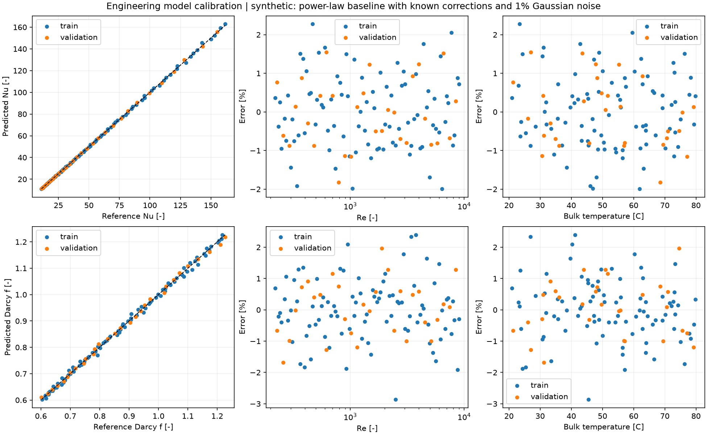

# Engineering Model Calibration

[](https://github.com/grenli415/engineering-model-calibration/actions/workflows/ci.yml)

Calibrate and validate steady engineering models from CSV/Excel references. Independent thermal
and hydraulic least-squares fits, held-out evaluation, Reynolds/temperature error bands and
portable reports. Python 3.11+; verified locally on Python 3.12.2, Windows, 2026-10-28.



The figure is an actual generated report on **synthetic data**, not manufacturer validation.

## Install and run

```bash
git clone https://github.com/grenli415/engineering-model-calibration.git
cd engineering-model-calibration
python -m venv .venv
# Windows: .venv\Scripts\activate
# Linux/macOS: source .venv/bin/activate
python -m pip install -e '.[dev]'
python examples/generate_synthetic.py
engineering-calibrate data/synthetic.csv --output report
# Excel also works:
engineering-calibrate data/synthetic.xlsx --output report-excel
```

Open `report/REPORT.md`, `report/comparison.png`, or the exported CSV/JSON files.
The deterministic synthetic dataset has 120 rows: 90 train and 30 validation, 1% seeded noise.
Known thermal truth `(scale=1.18, exponent=0.07)` and hydraulic truth `(0.86,-0.04)` allow a
reproducible recovery exercise. Generated coefficients were approximately `(1.17930,0.07140)`
and `(0.86202,-0.04139)`. Validation MAPE was **0.7267% thermal / 0.7302% hydraulic**.
These numbers measure synthetic recovery only; they say nothing about a real exchanger's accuracy.

## Input contract

Required columns:

```text
case_id,split,provenance,re,temperature_c,nu_base,nu_ref,f_base,f_ref
```

`split` is `train` or `validation`; `case_id` is unique; provenance is mandatory.
Re, Nu and Darcy friction factors are positive dimensionless numbers. Temperature is Celsius.
CSV and `.xlsx` first sheet are supported. Missing/nonfinite values and duplicate IDs are rejected.
Supply independent experimental or trusted-calculation references. Group repeated specimens/runs
before splitting to avoid leakage; unique IDs alone cannot establish independence.

## Models and diagnostics

`Nu_pred=Nu_base*a_T*(Re/1000)^b_T` and `f_pred=f_base*a_H*(Re/1000)^b_H`.
SciPy TRF nonlinear least squares minimizes relative residuals independently for the two models.
Parameter bounds, convergence, Jacobian rank/conditioning and active bounds are reported.
Underidentified problems are rejected. Validation data never enters optimization.

Reports contain:

* MAE, RMSE, MAPE and maximum absolute error, separately by split and model.
* Reynolds and temperature band metrics with sample counts.
* Per-row predictions, errors, relative errors and training-domain extrapolation flags.
* Parity plots and residuals versus Re and temperature.
* JSON coefficients/diagnostics, CSV metrics/predictions, Markdown and PNG reports.

See [methodology, equations, scientific sources and units](docs/METHODOLOGY.md).

## Python API and exchanger integration

```python
from engcal import load_data, calibrate, export_report

data = load_data("data/synthetic.csv")
fitted = calibrate(data)
export_report(data, fitted, "report")
print(fitted.platehx_correction())
```

For the [companion calculator](https://github.com/grenli415/plate-heat-exchanger-calculator):

```bash
python -m pip install '.[integration]'
engineering-calibrate data/synthetic.csv --output example-report
python examples/platehx_integration.py
```

The example demonstrates API interoperability using synthetic coefficients. Real calibration
must match the exchanger geometry, fluid, correlation variant and temperature domain. The
companion rejects Re extrapolation; its UI also checks the stored temperature interval.
Nu references require film heat-transfer information: overall measured U alone cannot uniquely
identify both side coefficients. Channel friction references require removing port and elevation losses.

## Architecture and checks

```text
src/engcal/core.py     schema, metrics, bounded fits, prediction and correction export
src/engcal/report.py   split/band summaries, JSON/CSV/Markdown, Matplotlib figures
src/engcal/cli.py      installed command and actionable import/fit errors
data/                 explicitly labelled synthetic CSV and Excel examples
example-report/       reproducible generated outputs
tests/                truth recovery, leakage invariants, imports, bad inputs, reports, integration
```

```bash
python -m pytest -q
ruff check .
ruff format --check .
python -m build
python scripts/scan_secrets.py
```

14 tests passed with the companion installed. CI first runs standalone tests (the optional
integration test skips), then installs the tagged companion and explicitly runs integration.
See [verification record](docs/VERIFICATION.md).

## Limits and provenance

Two positive dimensionless algebraic correction models are implemented. This is not a generic
ODE identification, uncertainty quantification or Bayesian framework. Temperature is analyzed,
not fitted as an additional term. There are no confidence intervals, errors-in-variables models,
uncertainty propagation or manufacturer/experimental validation claims. Active-bound fits and
extrapolated predictions need engineering review.

Architecture informed by [alphabench/aeroid](https://github.com/alphabench/aeroid), MIT.
No AeroID source, flight data or tests were copied; its ODE/aerospace capabilities are not claimed.
See [NOTICE](NOTICE.md), [observed history](docs/UPSTREAM_HISTORY.txt),
[retained upstream license](third_party/upstream-aeroid-LICENSE.txt). Original code is [MIT](LICENSE).
